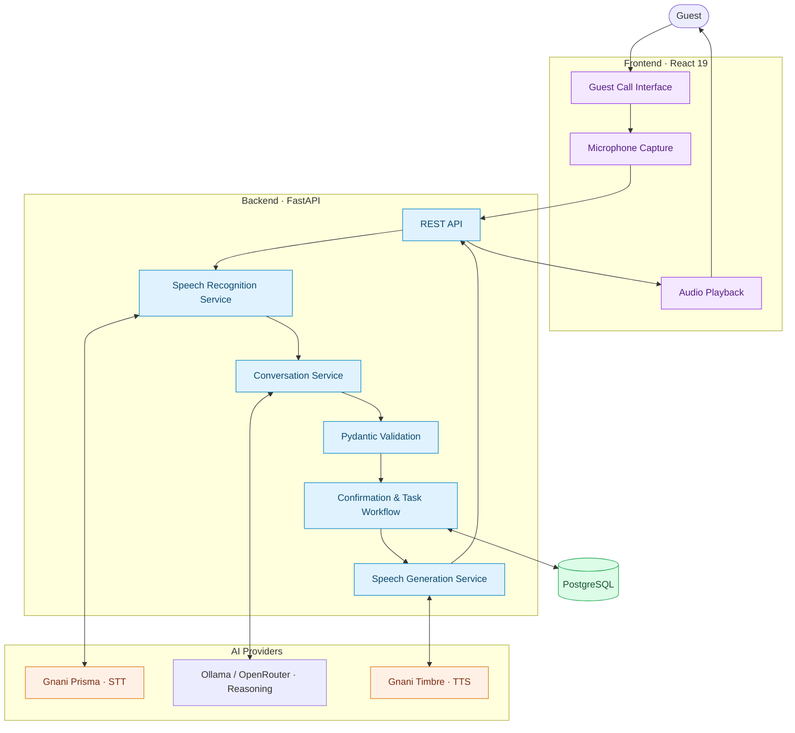

# ROOMLY — AI Voice-First Hotel Concierge

**A multilingual, voice-first hotel concierge powered by Gnani AI.**

## Problem Statement

Hotel guests often have to call reception, navigate phone menus, or wait for staff to get basic information or request assistance. Language barriers and unclear communication can make this process even more difficult.

**ROOMLY** solves this by providing a voice-based AI concierge that lets guests ask questions and request hotel services in their preferred language. Guests can speak naturally to report issues, request amenities, or get information about hotel facilities.

**No service request is created without the guest's explicit confirmation.**

# Gnani AI — Powering the Voice Experience

Gnani AI powers ROOMLY's voice interaction through two technologies:

- **Gnani Prisma (STT):** Converts guest speech into text.
- **Gnani Timbre (TTS):** Converts assistant responses into spoken audio.

A separate reasoning provider handles conversation understanding and service-request generation.

## Gnani Prisma — Speech-to-Text

ROOMLY captures guest audio and sends it to Prisma for transcription. The resulting text is passed to the reasoning layer.

| Configuration         | Version / Value |
| --------------------- | --------------- |
| Product               | Gnani Prisma    |
| Product documentation | v3.0            |
|

**Version note:** The `/stt/v3` endpoint does not confirm the runtime model version. ROOMLY uses the model reported by the provider; the current test fixture contains `prisma-v2.5`.

**Official documentation:** [Prisma v3.0 — Product](https://www.gnani.ai/resources/prisma-v3) · [STT API Reference](https://docs.gnani.ai/api/STT/speech-to-text)

## Gnani Timbre — Text-to-Speech

Timbre converts ROOMLY's responses into audio played directly to the guest.

| Configuration        | Version / Value         |
| -------------------- | ----------------------- |
| Product              | Gnani Timbre            |
| Configured model     | `timbre-v3.0`           |
| Voice                | `Avinash`               |

# Supported Languages

ROOMLY configures 11 selectable guest-language values.

| Application code | Guest language | STT handling |
|---|---|---|
| `en-IN` | English | Passed through |
| `hi-IN` | Hindi | Passed through |
| `hi-en` | Hinglish | Mapped to `hi-IN` |
| `ta-IN` | Tamil | Passed through |
| `te-IN` | Telugu | Passed through |
| `kn-IN` | Kannada | Passed through |
| `ml-IN` | Malayalam | Passed through |
| `mr-IN` | Marathi | Passed through |
| `bn-IN` | Bengali | Passed through |
| `gu-IN` | Gujarati | Passed through |
| `pa-IN` | Punjabi | Passed through |

The Avinash voice is mapped across all 11 configured guest-language values and covered by parameterized service tests.

**Official documentation:** [Timbre v3.0 — Product](https://www.gnani.ai/resources/timbre-v3) · [TTS API Reference](https://docs.gnani.ai/api/TTS/tts-inference)

## System Architecture

## Technology

⚛️ React 19 · ⚡ Vite · 🐍 Python · 🚀 FastAPI · 📦 Pydantic · 🗄️ PostgreSQL · 🧠 Ollama / OpenRouter · 🎙️ Gnani Prisma · 🔊 Gnani Timbre · 🧪 Pytest · 🛠️ Ruff · 🔄 GitHub Actions

## Engineering Approach

ROOMLY is developed incrementally, with clear service boundaries and automated validation.

- Provider integrations are separated from application logic.
- Pydantic models define structured data contracts.
- Service and API behavior is covered by pytest.
- Ruff and Pyright support code quality.
- GitHub Actions validates frontend and backend changes.

## Documentation

| Document | Description |
|---|---|
| [Technical Guide](docs/TECHNICAL_GUIDE.md) | Technology stack, versions, architecture, setup, testing, and development workflow. |
| [Gnani Prisma STT](docs/GNANI_PRISMA_STT.md) | Prisma integration, API configuration, audio processing, and language mapping. |
| [Gnani Timbre TTS](docs/GNANI_TIMBRE_TTS.md) | Timbre integration, model configuration, voice selection, and audio output. |
| [Reasoning Provider](docs/REASONING_PROVIDER.md) | Provider abstraction, Ollama, OpenRouter, and structured AI responses. |
| [System Architecture](docs/SYSTEM_ARCHITECTURE.md) | Application layers, request lifecycle, data flow, and service boundaries. |
| [Docker Guide](docs/DOCKER.md) | Build and run the frontend and backend containers with Docker Compose. |

## Project Scope

ROOMLY currently provides a browser-based hotel concierge call simulator. It does not implement PBX, SIP, or direct hotel telephone-system integration.

A service request is persisted only after the guest explicitly confirms the proposal.
