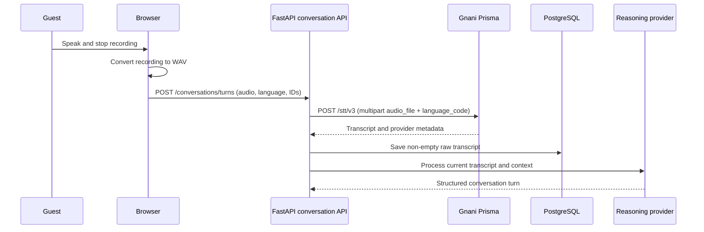

# Gnani Prisma STT in ROOMLY

## 1. Introduction

ROOMLY uses Gnani's speech-to-text API as the entry point for its browser-based
voice workflow. Prisma turns each completed guest recording into text; the
backend then persists that transcript and passes it to the configured
reasoning provider.

## 2. Role of Prisma in ROOMLY

Prisma handles speech recognition only. It does not classify service-request
intent, produce tasks, confirm requests or generate the spoken answer. Those
steps belong to ROOMLY's reasoning, validation, persistence and Timbre TTS
layers.

## 3. Speech recognition architecture



The primary UI submits completed turns to `/conversations/turns`. The backend
also contains earlier `/voice/ingest` and `/voice/confirm` routes that call the
same STT provider; they are not the current guest-call hook's primary path.

## 4. Frontend audio capture

The React guest-call interface uses the browser `MediaRecorder` API. It selects
the first supported format from WebM/Opus, MP4, WebM or Ogg/Opus. The recorder
stops its media tracks after producing a recording.

## 5. Browser MediaRecorder implementation

Microphone capture is managed by `useAudioRecorder`. It requests an audio-only
media stream, collects non-empty recorder chunks and publishes one `Blob` when
recording stops. Permission, unsupported browser, unavailable device and
interrupted capture conditions are surfaced to the UI.

## 6. Audio conversion and preprocessing

Before upload, `convertAudioToWav` decodes the recorded Blob with Web Audio and
encodes signed 16-bit PCM samples in a RIFF/WAVE container. The converter keeps
the decoded sample rate and channel count; it does not resample or downmix.
Audio conversion failure stops submission and returns a user-facing error.

The frontend sends the WAV Blob as `roomly-recording.wav`. The browser request
is multipart form data containing `audio`, `room_id`, `guest_language`, and an
optional `conversation_id`.

## 7. Backend ingestion workflow

The conversation endpoint reads the uploaded file and calls
`VoiceIngestionServices.process_conversation_turn`. That service:

1. Loads conversation context.
2. Calls `GnaniSTT.transcribe`.
3. Strips and rejects an empty transcript.
4. Persists a `RawInput` with room, conversation, language and transcript.
5. Calls the reasoning provider with the transcript and context.

The greeting, processing acknowledgement and continuation scripts do not pass
through STT. They are synthesized as TTS and are never persisted as guest
requests.

## 8. Gnani Prisma API integration

`GnaniSTT` sends a `POST` to:

```text
https://api.vachana.ai/stt/v3
```

The request is multipart form data:

| Field | Value |
|---|---|
| `language_code` | Explicit selected guest language, with `hi-en` mapped to `hi-IN` |
| `audio_file` | Original filename, WAV bytes from the current UI, and detected MIME type |

The `stt/v3` endpoint is the configured API version. The app does not set a
separate Prisma model in the request. The provider returns a `model` value.
Repository tests use `prisma-v2.5` as a mocked response value; this does not
prove that exact model is enabled for a deployment.

## 9. Authentication and request construction

The lifespan creates one `GnaniClient` with the configured
`GNANI_API_KEY_ID`. It sends the key in the `X-API-Key-ID` HTTP header. The
client is shared by the app's Prisma and Timbre adapters and is closed during
application shutdown.

## 10. API response handling

The response is validated against `GnaniSTTResponse`, requiring `success`,
`request_id`, `transcript` and `model`. Optional fields include
`processing_time`, `end_to_end_latency` and `output.literal`. Extra response
properties are ignored. Invalid JSON, an unexpected response shape, provider
failure or HTTP errors become `GnaniAPIError`.

The normalized provider-independent `TranscriptionResult` retains transcript,
optional literal transcript, provider name, model, request ID, processing time
and end-to-end latency.

## 11. Transcript processing

ROOMLY strips surrounding whitespace and rejects an empty transcript before
creating the raw-input database row. The transcript is the reasoning
provider's input; the guest's selected language and prior conversation
messages are supplied separately. No speech is reinterpreted as a task by the
STT adapter.

## 12. Language handling

The guest explicitly chooses one of 11 configured codes:

`en-IN`, `hi-IN`, `hi-en`, `ta-IN`, `te-IN`, `kn-IN`, `ml-IN`, `mr-IN`,
`bn-IN`, `gu-IN`, `pa-IN`.

No automatic language detection is implemented. Gnani's documented error
response lists provider-supported codes such as Assamese (`as-IN`) and
`indic-auto`, but ROOMLY does not expose those values as guest selections.
ROOMLY's `hi-en` selection is translated to `hi-IN` only when constructing the
Prisma request; the stored guest language remains `hi-en`.

## 13. Integration with the reasoning provider

After transcription and persistence, the conversation service calls
`process_turn` once with the current utterance, selected language and
conversation context. Pydantic validates the structured conversation result.
Prisma does not perform intent classification or service-request extraction.

## 14. Error handling and reliability

The HTTPX client has a 30-second default timeout for an individual Gnani HTTP
request. The browser allows up to 420 seconds for the whole conversation-turn
request, which can include queue wait, STT, reasoning and TTS.

Requests made through the shared Gnani client are serialized within one
backend process. A 429 response is retried up to three times, waiting 5, 15
and 30 seconds by default; a numeric `Retry-After` header takes precedence.
Transient 502, 503 and 504 gateway responses are retried up to twice, waiting
1 and 2 seconds. The same queue also serializes Timbre requests. This is
process-local and does not coordinate multiple workers or application
replicas.

The conversation API converts provider errors to a 502 response. The frontend
surfaces a processing error rather than presenting a successful result when
STT fails. The longer browser timeout should not be read as a provider SLA.

## 15. Latency and performance

No repository benchmark establishes Prisma latency. Total transcription time
depends on recording length and encoding, browser WAV conversion, upload
bandwidth, the provider's queue and service time, and any application-side
wait for the shared Gnani request lock or 429 backoff.

For a meaningful benchmark, record audio duration, browser conversion time,
upload time, Gnani request start/end and returned `processing_time`/
`end_to_end_latency`, then calculate total time from recording stop to
transcript availability. Collect distributions over a representative language
and network matrix; do not infer recognition accuracy from latency.

## 16. Testing and evaluation

The repository's provider tests mock HTTP responses and validate request
construction, authentication, returned fields, malformed responses,
serialization and retry behavior. The STT-specific tests cover the English
request shape and Hinglish-to-Hindi mapping. Broader conversation tests use
stubbed STT/reasoning providers. These tests are not live-provider tests and
do not measure recognition accuracy.

## 17. Configured versus tested language coverage

| Coverage type | Verified coverage |
|---|---|
| Guest language configuration | 11 codes listed above |
| STT language normalization | `hi-en` maps to supported `hi-IN` |
| STT provider request tests | English and Hinglish mapping, with mocked responses |
| Live STT language evaluation | Not present in the repository |

Configured values must not be presented as tested recognition-quality
coverage. A deployment should evaluate transcription quality with consented,
representative recordings in each target language.

## 18. Limitations

- The exact Prisma model selected for the deployed account is not specified in
  the application request.
- The browser converter does not resample or downmix audio.
- Live accuracy and latency benchmarks are absent.
- Rate-limit locking works only within one backend process.
- The browser-based call is not a hotel phone, PBX or SIP integration.

## 19. Future improvements

- Expose verified provider model metadata and maintain a deployment-level model
  record.
- Add opt-in, consent-aware language and audio quality evaluation.
- Measure conversion, upload, provider and end-to-end latency separately.
- Consider cross-worker request coordination if production deployment uses
  multiple workers and the provider continues to enforce a global concurrency
  limit.
- Evaluate server-side audio normalization if provider guidance or measured
  compatibility issues justify it.
