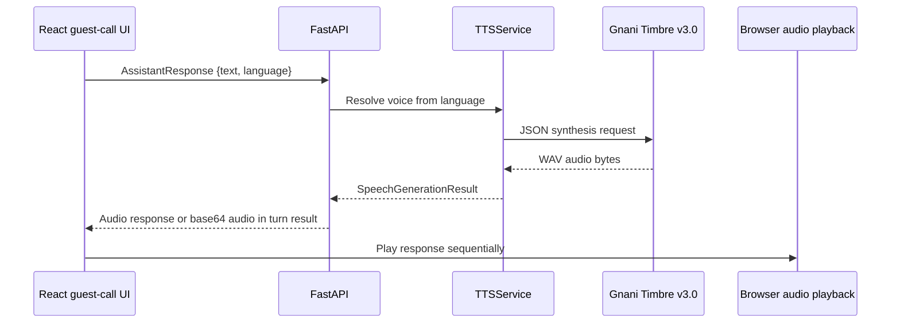

# Gnani Timbre TTS in ROOMLY

## 1. Introduction

Gnani Timbre is ROOMLY's text-to-speech provider. The backend sends assistant
text and a guest-language code to Gnani, receives audio bytes, and returns
those bytes either as a standalone audio response or embedded in a
conversation-turn response.

## 2. Role of Timbre in ROOMLY

Timbre voices the hotel's side of the interaction: the assistant's response
to a request, a predefined greeting, a delayed processing acknowledgement, a
continuation question, or a closing message. Timbre does not decide the
conversation intent, generate task data or persist service requests.

## 3. TTS architecture



Conversation-turn responses contain both structured turn data and synthesized
audio. The frontend scripts for greeting, acknowledgement and continuation
instead call the standalone `/voice_generate/` route.

## 4. Backend TTS service

`TTSService` accepts an `AssistantResponse`, keeps its text and language, and
selects the voice from `TTS_VOICE_MAPPING`. It delegates synthesis to the
Gnani adapter. There is no separate response-rewriting or SSML conversion
layer: inline text tags, when present, are passed through as ordinary text
content in the JSON request.

## 5. Gnani API integration

The lifespan configures `GnaniTTS` with model `timbre-v3.0`. It sends requests
to:

```text
https://api.vachana.ai/api/v1/tts/inference
```

The shared Gnani client supplies the `X-API-Key-ID` authentication header,
serializes calls through a process-local lock and retries 429 responses using
the configured waits or a numeric `Retry-After` header. Transient 502, 503
and 504 gateway responses are retried up to twice, waiting 1 and 2 seconds.

## 6. Request construction

The adapter sends JSON with these fields:

| Field | Current value/source |
|---|---|
| `text` | Assistant response or predefined script |
| `voice` | Resolved voice, with adapter fallback `Nalini` |
| `model` | `timbre-v3.0` from application lifespan |
| `language` | Guest-selected language code |
| `speed` | Adapter default `1.0` |
| `audio_config.encoding` | `linear_pcm` |
| `audio_config.container` | `wav` |
| `audio_config.num_channels` | `1` |
| `audio_config.sample_rate` | `48000` |
| `audio_config.sample_width` | `2` bytes |

The service passes the configured voice explicitly, so the adapter's default
voice is not used in the normal `TTSService` path.

## 7. Model and voice configuration

The active TTS model configured in application lifespan is **Timbre
`timbre-v3.0`**. Every configured guest-language code currently maps to
**`Avinash`**. This reflects the current code and tests; voice availability or
pronunciation quality for a particular language should be confirmed with the
provider and a live evaluation.

## 8. Language mapping

The voice mapping includes `en-IN`, `hi-IN`, `hi-en`, `ta-IN`, `te-IN`,
`kn-IN`, `ml-IN`, `mr-IN`, `bn-IN`, `gu-IN` and `pa-IN`. `hi-en` is passed as
the TTS language unchanged; the STT adapter separately maps that value to
`hi-IN`.

The mapping test is parameterized across these 11 codes and checks that
`TTSService` chooses `Avinash`. That test verifies request selection, not
pronunciation or intelligibility for all languages.

## 9. Audio response handling

The Gnani client requires a successful HTTP response with a non-empty body and
an `audio/*` content type. The adapter returns the raw response bytes and
content type as `SpeechGenerationResult`.

The conversation endpoint base64-encodes those bytes and includes their
content type in the turn response. The standalone `/voice_generate/` endpoint
returns the bytes directly with the provider's media type.

## 10. Frontend audio playback

The frontend validates the standalone TTS response as a non-empty audio Blob.
The playback helper creates an object URL, plays it with the browser's native
`Audio` element, then pauses and releases the URL. It supports cancellation
and stops any previous active playback before starting a new one.

An initial greeting is preceded by a locally synthesized 500 ms Web Audio
chime. The chime does not call Timbre. If Web Audio is unavailable, the
greeting continues without the chime.

## 11. Expressive speech and conversational delivery

Script text is sent inline, with tags in the same `text` field as spoken words.
The current predefined scripts use `<slow>` for routine processing
acknowledgement and `<pauses>` in the greeting/acknowledgement. The English
end-intent closing response includes `<excited>`. Other ordinary continuation
scripts do not add an expression tag. Tags are not converted to SSML in
ROOMLY.

Tag delivery depends on the configured Timbre model/provider behavior; the
repository does not contain independent validation of how a live voice
renders each tag.

## 12. Greeting and welcome behavior

After an explicit room-entry action, or when a guest explicitly starts a call
from a restored session, the browser plays the chime and then requests the
predefined greeting in the selected language. The greeting is not generated
by the reasoning provider and is not submitted as a service request. A page
reload alone does not replay the greeting.

The current greeting script table contains all 11 configured language codes.
This confirms script configuration, not native-speaker review or live TTS
quality for each locale.

## 13. Processing acknowledgements

The frontend starts a 700 ms timer when it submits a guest turn. If the
conversation-turn response has not returned when the timer fires, it requests
a predefined acknowledgement through `/voice_generate/`. If the actual turn
returns first, the acknowledgement is skipped. When the main response is
ready, its controller is aborted before response playback, preventing
acknowledgement audio from overlapping the answer.

The acknowledgement is a second TTS request only when the threshold is
reached; it does not invoke the reasoning provider.

## 14. Continuation prompts

After the actual response audio finishes, the UI requests and plays a
predefined continuation prompt in the selected language. Only after that
prompt completes does it resume microphone recording. Continuation text is
not sent as a conversation request.

## 15. Closing messages

When the existing `END_CONVERSATION` intent is returned and no proposal is
awaiting confirmation, the backend replaces the model-authored text with a
fixed localized closing response before synthesis and then ends the
conversation.

A valid service-request confirmation also closes the conversation after
backend persistence, but currently uses a separate fixed confirmation
acknowledgement (`CONFIRMATION_RESPONSE`), which is English and not the
localized end-intent closing script. This behavior should not be described as
a localized goodbye on confirmation.

## 16. Audio sequencing and cancellation

The guest-call flow sequences greeting/chime, recording, optional
acknowledgement, response, continuation and the next recording. Abort
controllers cancel outstanding frontend TTS requests and playback on
component unmount or when the response supersedes an acknowledgement. The
playback helper also stops previous audio before starting another clip.

The shared backend Gnani client serializes STT and TTS HTTP requests within a
single process. This supports the provider's one-active-request constraint,
but can add queue delay when requests overlap. A deployment with multiple
backend processes has no shared distributed lock.

## 17. Error handling and reliability

The adapter rejects empty text and validates non-empty audio response bytes
and content type. The conversation endpoint converts TTS provider errors to
HTTP 502. The frontend reports failed synthesis or playback rather than
pretending playback succeeded. The standalone TTS route relies on FastAPI's
exception handling and does not have the same explicit provider-to-502
translation in its route implementation.

The shared Gnani HTTP client uses a 30-second per-request timeout. TTS requests
are serialized; 429 retries can wait 5, 15 and 30 seconds, unless the
provider supplies a numeric `Retry-After`. Transient 502, 503 and 504 gateway
responses are retried up to twice, waiting 1 and 2 seconds. No end-to-end
response-time guarantee is configured.

## 18. Latency and performance

No measured TTS generation or guest-perceived latency figures are published in
the repository. Perceived delay includes queue wait, provider synthesis time,
response transfer and browser playback startup. The 700 ms acknowledgement
threshold is a frontend behavior, not a measured TTS latency claim.

A useful benchmark should record request queue wait, provider request/response
duration, audio bytes and duration, response transfer time, playback start,
and total time from guest submission to first spoken audio. Measure main
responses and scripted prompts separately.

## 19. Testing and evaluation

The TTS service test checks the voice selection for all 11 configured
languages and its fallback for an unmapped language. Provider/client tests
mock successful and invalid HTTP audio responses. Conversation API tests
check that fixed closing/confirmation text is synthesized.

These are mocked tests. The repository does not include live Timbre tests,
voice-quality evaluation, audio-tag rendering assertions or latency
benchmarks.

## 20. Configured versus tested languages

All 11 configured codes are covered by the voice-mapping unit test and
predefined greeting/acknowledgement/continuation script entries. Automated
mapping coverage does not demonstrate correct live synthesis, native
pronunciation or tag rendering in every language. No live language quality
matrix is present.

## 21. Limitations

- The current voice mapping is `Avinash`, not `Shivani`.
- The confirmation acknowledgment is English-only, even for non-English
  conversations.
- Live voice quality, latency and inline-tag behavior are not benchmarked.
- A process-local request queue cannot enforce a global limit across multiple
  backend workers.
- The browser chime is an acoustic cue, not a telephony ring tone.

## 22. Future improvements

- Evaluate the configured voice and scripts with speakers of each supported
  language.
- Add measured synthesis and playback-start latency distributions.
- Verify inline expression-tag rendering against the live Timbre v3.0 service.
- Localize the fixed confirmation acknowledgment while preserving its
  server-owned, non-LLM behavior.
- Consider cross-worker Gnani request coordination if required by deployment
  scale.
