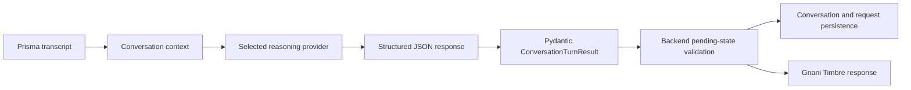

# ROOMLY reasoning provider

## 1. Introduction

ROOMLY's reasoning layer receives a transcript and explicit language/context,
then returns structured conversation data. It decides whether the latest guest
utterance is a new request, confirmation, rejection, modification, general
conversation, end intent or unclear. It is separate from both Gnani speech
recognition and speech generation.

## 2. Reasoning provider responsibility

The provider interprets text and produces structured output. Backend services
and schemas remain responsible for validating the result, reconciling it with
the actual pending proposal, persisting conversation state and creating
service-request rows after valid confirmation.

## 3. Current provider and model

`REASONING_PROVIDER` selects the implementation in the provider factory.
Application settings default to:

| Setting | Default |
|---|---|
| `REASONING_PROVIDER` | `ollama` |
| `REASONING_MODEL` | `qwen3:8b` |
| `OLLAMA_BASE_URL` | `http://localhost:11434` |
| `OPENROUTER_BASE_URL` | `https://openrouter.ai/api/v1` |

Ollama is therefore the source-code default; OpenRouter is available when
selected through configuration. The repository alone cannot prove which
provider is selected in a particular deployment.

The OpenRouter adapter declares model
`nvidia/nemotron-3.5-super-vl:free`. Although the factory passes
`REASONING_MODEL` into the adapter, the adapter currently assigns its own
`MODEL` constant to `self.model`; therefore that environment setting does not
currently change the OpenRouter model. Verify the deployed provider/model
configuration before describing it as active.

## 4. Provider abstraction

`ReasoningProvider` is a Python `Protocol` describing `process_turn`,
`extract_tasks` and `generate_response`. Both the Ollama and OpenRouter
implementations provide these operations. The factory returns the provider
selected from settings and rejects unsupported provider names.

The active conversation path calls `process_turn`. An older ingestion path
uses the task-extraction and response-generation methods separately.

## 5. Provider factory

The factory reads the application settings when resolving a provider:

```text
REASONING_PROVIDER=ollama     -> OllamaProvider
REASONING_PROVIDER=openrouter -> OpenRouterProvider
other value                   -> ValueError
```

Ollama uses its `/api/chat` endpoint. OpenRouter uses
`/chat/completions` under the configured OpenAI-compatible base URL. API keys
are read from environment-backed settings and are not documented as literal
values.

## 6. Request and response lifecycle

For the primary voice workflow:



The conversation service calls `process_turn` once per processed guest turn;
provider calls are not repeated for each intent or task inside this path. The
providers request non-streaming structured output. Ollama receives the
`ConversationTurnResult` JSON schema through its `format` field.
OpenRouter receives a strict `json_schema` response-format declaration.

## 7. Intent classification

The Pydantic `ConversationIntent` enum defines:

- `NEW_REQUEST`
- `CONFIRMATION`
- `REJECTION`
- `MODIFICATION`
- `GENERAL_CONVERSATION`
- `END_CONVERSATION`
- `UNCLEAR`

The system prompt distinguishes the newest guest utterance from history. It
guides the model to treat a clear approval as confirmation even when paired
with a goodbye, retain actionable new requests even if the guest says goodbye,
and avoid ending when a proposal is still awaiting a decision.

This intent decision is probabilistic model output, not a deterministic
language-wide rule. The backend applies additional guards before closing or
creating records.

## 8. Structured output

`ConversationTurnResult` requires an intent, a list of proposed service
requests and an `AssistantResponse`. Extra top-level fields are forbidden.
The response carries non-empty text and a language value. A proposed task
requires a category, non-empty staff summary and priority.

Providers parse JSON into these Pydantic models. Invalid or missing fields do
not become a successful assistant result.

## 9. Pydantic validation

The application uses Pydantic models for input/output contracts and
provider-returned structured JSON. `model_validate_json` parses provider
content into typed models. Enum fields constrain allowed intent, category and
priority values. This provides a validation boundary; it does not establish
that a model's interpretation is semantically correct.

## 10. Task extraction and categorization

Actionable tasks use categories `HOUSEKEEPING`, `MAINTENANCE`, `FRONT_DESK` or
`OTHER`, and priorities `LOW`, `MEDIUM` or `HIGH`. The prompt asks for concise
English staff summaries and preserved quantities/details. ROOMLY returns
these structured proposals to the guest for confirmation; they are not yet
submitted hotel requests.

The older text-ingestion flow uses `TaskExtractionServices` and then asks the
provider to generate an assistant response from the extraction. The current
conversation-turn flow uses a single structured turn call.

## 11. Confirmation

The backend fetches the latest persisted pending proposal. If the model returns
`CONFIRMATION` and a proposal exists, the backend replaces model-returned tasks
with the stored complete pending task list. It creates service-request rows
from those validated tasks and returns a fixed server-owned acknowledgment.
This valid confirmation also ends the conversation.

If no pending proposal exists, a purported confirmation is changed to
`UNCLEAR`; it does not create service requests or end the conversation.

## 12. Rejection

A `REJECTION` clears the pending proposal state and does not create service
requests. The backend persists the assistant turn with an empty pending-task
list.

## 13. Modification

A `MODIFICATION` is expected to return the complete revised task list. The
prompt says not to return only the changed item and to use `UNCLEAR` when the
intended change is ambiguous. Backend persistence records the revised
proposal, which remains subject to confirmation.

## 14. Conversation context

Conversation context is loaded from persisted guest and assistant messages.
Pending proposal metadata is stored with the latest assistant turn and
retrieved by `ConversationServices.get_pending_proposal`. The latest proposal
is authoritative; the model is instructed not to re-extract old requests
from prior turns.

ROOMLY sends the selected language explicitly. Language selection is a guest
input; automatic language detection is not implemented.

## 15. Backend validation and persistence

The backend, rather than the reasoning model, owns side effects. It verifies
pending proposal state, validates confirmation, creates `ServiceRequest`
records only for an accepted proposal, stores the conversation turn, and
updates conversation status when closure is valid.

An `END_CONVERSATION` result while a proposal is pending is converted to
`UNCLEAR` with a localized fixed prompt asking whether to send the request.
Thus, a farewell cannot discard an unconfirmed proposal. A standalone end
intent with no pending proposal uses the server's localized closing script.

## 16. Error handling

Provider HTTP errors are raised by the adapters and handled by API routes.
Provider JSON is validated before it is treated as an application result.
Empty transcripts are rejected. The conversation endpoint maps upstream
speech/reasoning failures to HTTP 502 and invalid transcript/value failures
to HTTP 422. Invalid reasoning output is not treated as a successful
confirmation.

## 17. Performance considerations

No reasoning latency measurements are committed. The OpenRouter adapter has
a 120-second HTTP timeout; Ollama has a 180-second timeout. Actual turn time
also includes audio conversion/upload, Gnani STT queue and service time,
database work, and later TTS generation/playback. The frontend begins a
predefined processing acknowledgment after 700 ms while the backend turn is
still pending; this does not add another reasoning call.

Benchmark provider latency separately from the whole guest turn, recording
provider selection/model, request duration, response validation time and
overall submission-to-first-audio time.

## 18. Limitations and future scope

- The source default is Ollama, not OpenRouter; the deployed selection must be
  checked in its environment.
- OpenRouter's model constructor currently ignores the model argument passed
  by the factory and uses its class constant.
- No live reasoning accuracy, hallucination-rate or latency benchmark is
  included.
- Prompts guide multilingual intent understanding, but no evaluated
  language-by-intent test matrix is present.
- Model output can still misclassify ambiguous language; backend pending-state
  checks protect critical confirmation and closure side effects.
- Provider timeouts and the Gnani request queue can make the complete voice
  interaction feel slow; no production SLA is claimed.
