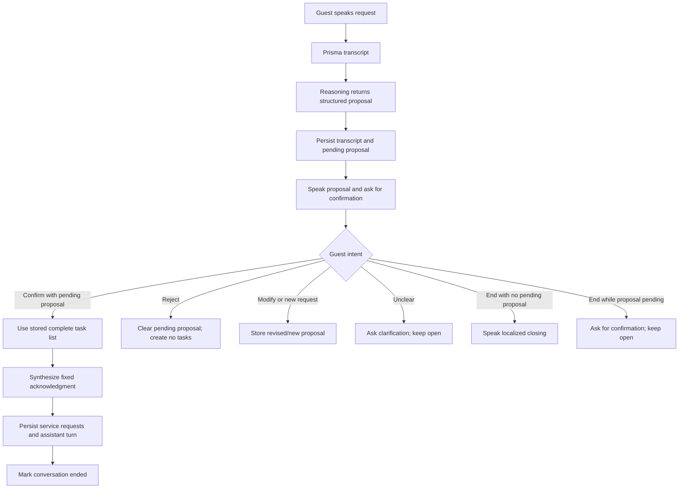
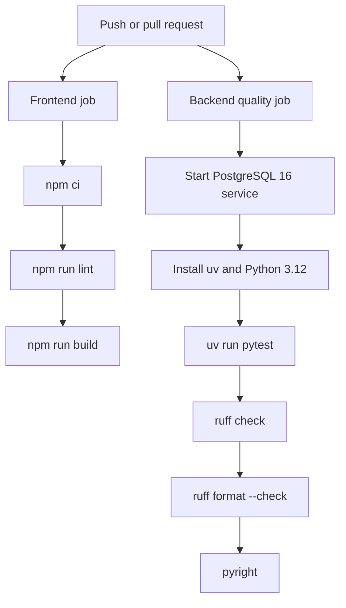

# ROOMLY system architecture

## 1. System overview

ROOMLY is a browser-based hotel concierge with a FastAPI backend. A guest
chooses a room and language, records a voice turn, and receives spoken
feedback. Gnani Prisma transcribes the audio; the configured reasoning
provider interprets the transcript; Pydantic contracts and backend workflow
rules validate intent and task data; SQLAlchemy persists conversation and
service-request state; Gnani Timbre synthesizes the spoken response.

The current interface simulates a call in the browser. The repository does
not implement a telephone, SIP or PBX integration.

## 2. Architectural style

The backend is a modular application in one FastAPI process, organized around
API routers, provider adapters, Pydantic schemas, services and SQLAlchemy
models. The frontend is a React/Vite client that communicates with the REST
API. Third-party speech and reasoning calls are made from the backend except
that predefined speech is requested by the frontend through the backend's
TTS endpoint.

The architecture uses explicit contracts and service boundaries, but it is
not a distributed microservice system. Gnani STT and TTS share one HTTP client
created at application startup.

## 3. Frontend architecture

The React application has room-entry, guest-call, header and voice-control
components. `useAudioRecorder` owns microphone access and MediaRecorder
lifecycle. Audio utilities decode a supported browser recording and encode
16-bit PCM WAV. `useConversationTurn` submits completed recordings, holds the
conversation ID, plays response audio, and coordinates acknowledgement,
continuation and automatic listening.

Guest room/language selection is stored in browser local storage. A freshly
entered room starts the greeting flow; restoring a saved session after page
reload does not automatically play the greeting. Guest-call audio playback
uses browser-native audio; the brief pre-greeting chime uses Web Audio.

The frontend is JavaScript/JSX (not TypeScript). Its package scripts expose
Vite development/build and ESLint; no frontend test runner is configured.

## 4. Backend architecture

FastAPI routers expose room, raw-input, service-request, task-extraction,
voice, TTS and conversation endpoints. Dependency functions supply a SQLAlchemy
session, shared Gnani adapters and the configured reasoning provider.

The main voice workflow is:

1. `/conversations/turns` creates a conversation if no conversation ID is
   provided, or validates an active ID and matching room/language.
2. The route reads the uploaded audio and calls
   `VoiceIngestionServices.process_conversation_turn`.
3. The service transcribes audio, persists a non-empty `RawInput`, loads
   context and calls the reasoning provider once.
4. The route validates the model intent against persisted pending-proposal
   state, synthesizes the server-approved response and commits the turn and
   any confirmed service requests.
5. It returns turn data and base64-encoded audio to the browser.

## 5. Gnani Prisma integration

`GnaniSTT` sends multipart audio and `language_code` to `/stt/v3`. The browser
currently converts MediaRecorder output to WAV before upload. The STT adapter
maps internal Hinglish code `hi-en` to Gnani's supported `hi-IN`, without
changing the guest language stored by ROOMLY.

Details, request/response fields, retries and verified limitations are in
[GNANI_PRISMA_STT.md](GNANI_PRISMA_STT.md).

## 6. Reasoning provider integration

The `ReasoningProvider` protocol and factory support Ollama and OpenRouter.
The source default is Ollama with `qwen3:8b`; OpenRouter is selected through
runtime configuration and its adapter currently uses the hard-coded model
`nvidia/nemotron-3.5-super-vl:free`. The repository does not establish which
provider a deployment selects.

The primary conversation path requests a structured `ConversationTurnResult`
from one provider call. Pydantic validation constrains intent, task category,
priority and response data. Backend logic, rather than the model, authorizes
request persistence and conversation closure.

See [REASONING_PROVIDER.md](REASONING_PROVIDER.md) for intent and validation
details.

## 7. Gnani Timbre integration

The application configures Gnani Timbre `timbre-v3.0`. `TTSService` maps all
11 configured guest-language codes to the current `Avinash` voice. It
requests mono 48 kHz, 16-bit linear PCM in a WAV container. The frontend uses
the same TTS route for predefined messages.

See [GNANI_TIMBRE_TTS.md](GNANI_TIMBRE_TTS.md) for scripted speech, tag usage,
audio sequencing and provider behavior.

## 8. Database and persistence

SQLAlchemy uses a PostgreSQL connection configured by `DATABASE_URL`; Alembic
contains seven tracked migrations. Models represent:

| Entity | Purpose |
|---|---|
| `hotel_rooms` | Room number and active state |
| `roomly_conversations` | Room, selected language, active/ended state and timestamps |
| `raw_inputs` | Guest transcript, language and related conversation |
| `roomly_conversation_messages` | Guest/assistant conversation history |
| `service_requests` | Confirmed task records, categories, priorities and status |

Pending task data is serialized with the latest assistant conversation
message and can be retrieved as the authoritative proposal. It is not a
service-request record until confirmation is validated.

## 9. API communication

The principal routes are:

| Route | Responsibility |
|---|---|
| `POST /conversations/turns` | Create/resume a conversation and process a guest audio turn |
| `POST /conversations/{conversation_id}/turns` | Process audio for a known active conversation |
| `POST /voice_generate/` | Synthesize supplied assistant text |
| `POST /voice/ingest` | Legacy ingestion/extraction flow |
| `POST /voice/confirm` | Legacy voice-confirmation flow |
| `/hotel_room/` | Room lookup and creation |
| `/service-requests/` | Service-request list, creation, retrieval and status update |

The frontend submits multipart turn data. The conversation response carries
the `conversation_id`, whether the conversation ended, raw transcript, typed
turn and audio encoded as base64 with a content type.

## 10. End-to-end guest interaction

```mermaid
sequenceDiagram
    actor Guest
    participant Browser as React browser app
    participant API as FastAPI
    participant Prisma as Gnani Prisma
    participant Reasoning as Configured reasoning provider
    participant DB as PostgreSQL
    participant Timbre as Gnani Timbre

    Guest->>Browser: Select room/language and start
    Browser->>Timbre: Request predefined greeting
    Timbre-->>Browser: Greeting WAV
    Browser->>Guest: Local chime, then greeting
    Guest->>Browser: Speak request
    Browser->>Browser: Record and convert to WAV
    Browser->>API: POST /conversations/turns
    API->>Prisma: Transcribe selected-language audio
    Prisma-->>API: Transcript
    API->>DB: Save raw input and load context/proposal
    API->>Reasoning: One structured conversation-turn request
    Reasoning-->>API: Intent, task proposal and response
    API->>Timbre: Synthesize approved response
    Timbre-->>API: Response WAV
    API->>DB: Persist turn and confirmed requests; end if required
    API-->>Browser: Turn data and base64 audio
    Browser->>Guest: Play response, then continuation prompt
    Browser->>Guest: Resume microphone listening
```

In the current implementation, greeting TTS is requested directly from the
browser through ROOMLY's TTS API. It does not create a conversation or service
request; the conversation record is created on the first submitted audio
turn.

## 11. Confirmation and persistence workflow



The route creates service-request objects only when the current intent is
`CONFIRMATION` and the database contains a pending proposal. It replaces
model-supplied confirmation tasks with the complete stored task list. If no
pending proposal exists, it changes the purported confirmation to
`UNCLEAR`.

An end intent while there is a pending proposal is also changed to `UNCLEAR`
and gets a fixed localized question. A standalone end intent with no pending
proposal gets a fixed localized closing and ends the conversation. A valid
request confirmation also ends the conversation after task persistence, but
its acknowledgment is the separate fixed English `CONFIRMATION_RESPONSE`.

## 12. Error handling

Gnani HTTP errors, malformed provider payloads, empty transcripts and
reasoning failures do not produce success-shaped conversation results.
Conversation processing maps speech/reasoning provider errors to HTTP 502 and
input/value errors to HTTP 422. TTS generation errors in conversation turns
are explicitly mapped to HTTP 502.

Gnani calls pass through one shared, process-local async lock. A 429 triggers
up to three retries with 5/15/30-second delays unless a numeric `Retry-After`
header is provided. Transient 502/503/504 gateway responses trigger up to two
retries with 1/2-second delays. If several API workers or replicas are used,
they do not share this in-memory lock.

The browser coordinates its acknowledgement, answer, continuation and
greeting audio with cancellation. A frontend timeout does not guarantee that
an upstream request has been cancelled by the provider.

## 13. Security and configuration

Gnani and OpenRouter credentials are read from backend environment-backed
settings. Do not put credentials in frontend variables or source control. The
frontend stores room ID, room number and chosen language in local storage;
this is client state, not an authentication mechanism.

The backend CORS configuration currently allows `http://localhost:5173`.
No Docker, TLS termination, secrets manager or deployment security
configuration is tracked. The inspected routes do not show application
user-authentication dependencies; production exposure and authorization need
separate review.

## 14. Technology stack

| Layer | Implementation |
|---|---|
| Browser UI | React 19, Vite, JSX, Axios |
| Capture/playback | MediaRecorder, Web Audio API, native Audio |
| API | FastAPI and HTTPX |
| Contracts | Pydantic models and enums |
| Persistence | SQLAlchemy ORM, PostgreSQL, Alembic |
| STT | Gnani Prisma endpoint `/stt/v3` |
| TTS | Gnani Timbre `timbre-v3.0` |
| Reasoning | Configurable Ollama or OpenRouter adapter |
| Quality | Pytest, pytest-asyncio, Respx, Ruff, Pyright, ESLint |
| CI | GitHub Actions |

## 15. Testing and CI/CD architecture

At the documentation audit baseline, `uv run pytest` collected 97 backend
test cases and all 97 passed: 7 API, 14 provider, 67 service, 6 unit and 3
health cases. They include parameterized and mocked provider tests; they are
not 97 live-provider or full browser end-to-end scenarios. The frontend has
no configured test suite.

The GitHub Actions workflow runs on pushes and pull requests:



The workflow configures validation only; it has no deployment job. It also
selects Python 3.12 while `pyproject.toml` requires Python 3.14 or newer and
`.python-version` is 3.14. CI compatibility should be corrected and its
successful status verified before claiming a passing pipeline.

Git history had 146 commits at the pre-documentation audit baseline; that
point-in-time count is a development-history observation, not a test or
quality metric. The documentation set is being committed one file at a time
for reviewable history.

## 16. Current limitations

- The exact deployed Prisma model version is not set by the request code.
- The source-selected reasoning default is Ollama; deployment configuration
  must be checked to determine the active provider.
- OpenRouter's adapter model is hard-coded despite receiving a configurable
  model parameter.
- No live language quality, STT accuracy, end-to-end latency or TTS quality
  benchmarks are stored in the repository.
- Multiple backend workers do not share the Gnani request lock.
- Frontend browser end-to-end tests, Docker packaging, telephony and
  deployment automation are absent.
- Confirmation closes the conversation with an English fixed acknowledgment;
  that acknowledgment is separate from the localized end-intent closing.

## 17. Future improvements

- Fix and validate the Python version agreement between project metadata and
  CI.
- Add browser-level tests for microphone lifecycle, playback sequencing and
  confirmation interactions.
- Measure STT, reasoning and TTS latency separately and end to end.
- Evaluate transcription and speech quality in each configured language.
- Add shared request coordination if multiple workers must obey a provider-wide
  single-active-request quota.
- Localize the fixed confirmation acknowledgment and validate the intended
  closure experience.
- Add deployment automation and operational configuration only when those
  deployment requirements are defined.
